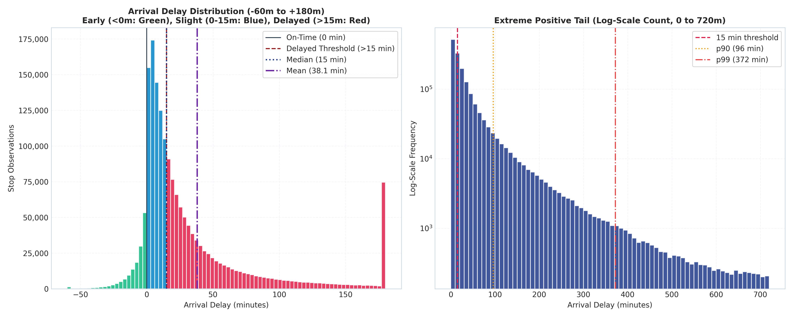
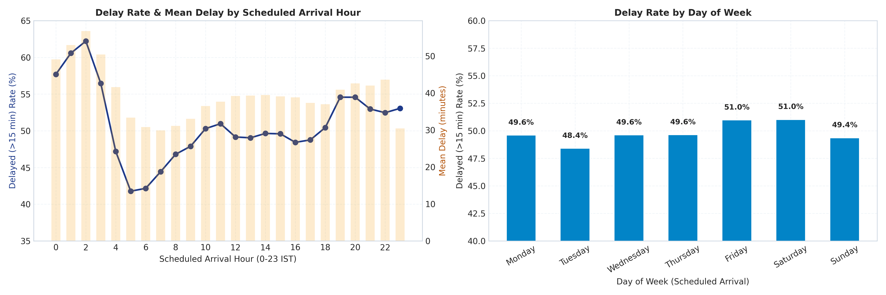
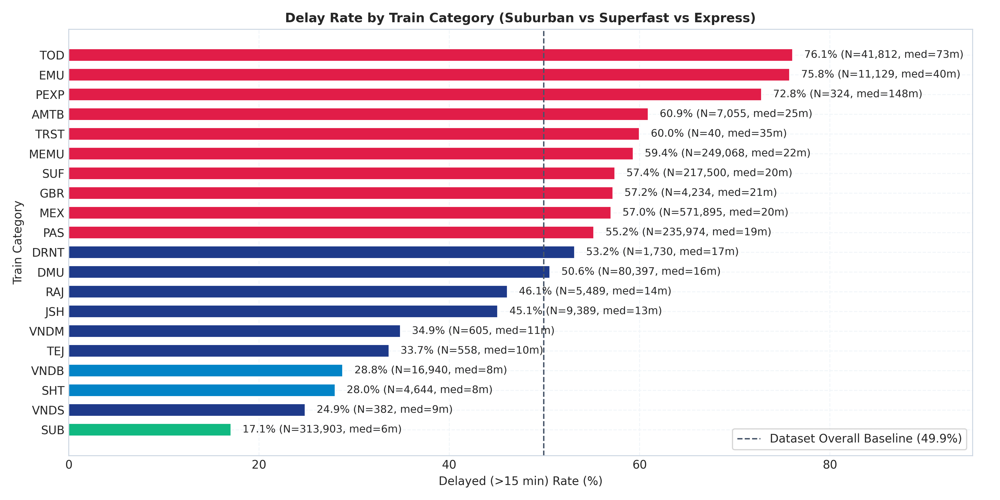
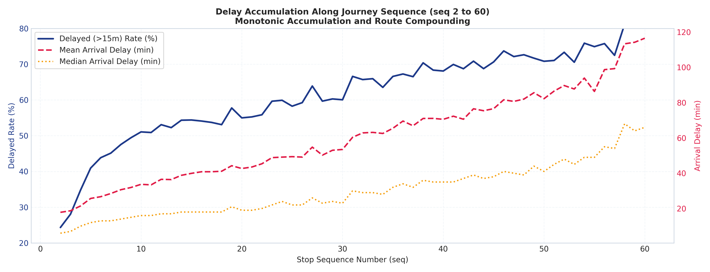
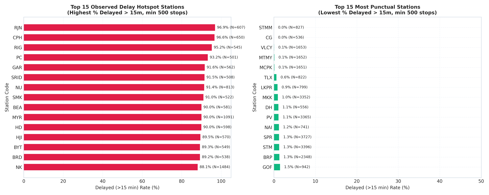
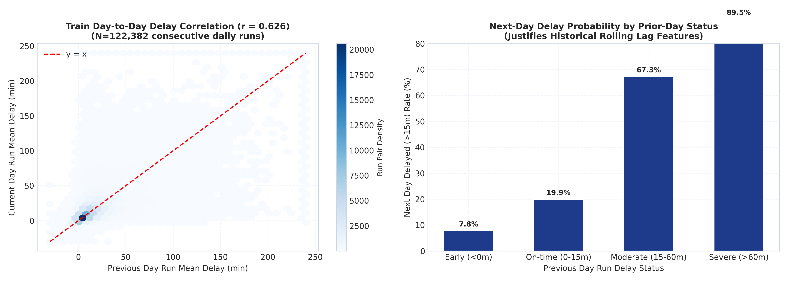
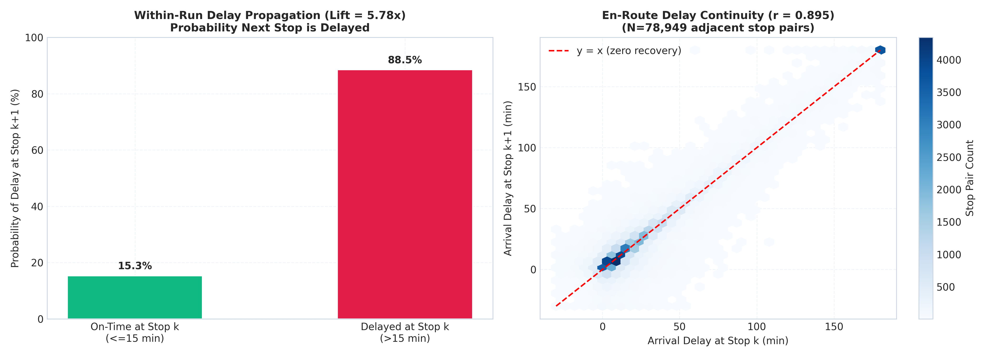
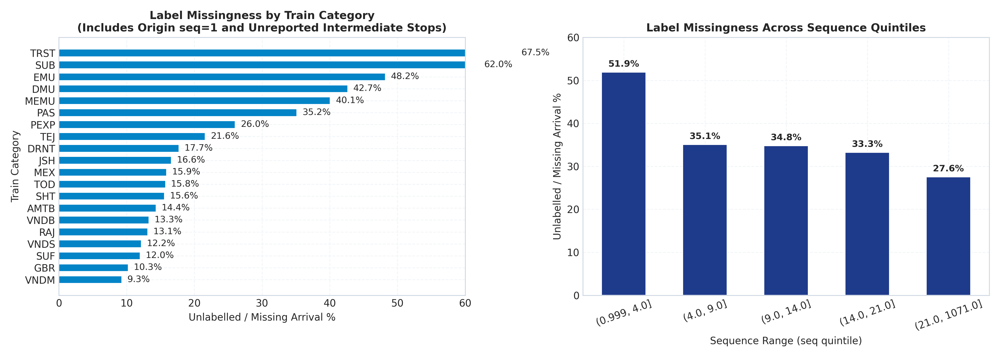

# RailSense — Exploratory Data Analysis (EDA) Report

> **Dataset Scope:** 2,805,574 stop observations across 147,367 train runs (2026-10-07 to 2026-10-25).  
> **Eligible Labelled Set:** 1,773,068 stops meeting criteria `arrival_delay_min IS NOT NULL`, `arrival_reported == 1`, `seq > 1`, and `|delay| <= 1440m`.  
> **Methodology:** Publication-quality visual analysis paired with exact descriptive metrics, correlation coefficients, and explicit methodological caveats.

---

## 1. Overall Delay Distribution & Extreme Values

### Key Metrics
- **Eligible Observations:** `1,773,068`
- **Negative Delays (Early Arrivals):** `8.56%` (valid operations; early arrivals are frequent at intermediate buffer stops).
- **On-Time (Delay == 0):** `2.88%`
- **Delayed (>15 min):** `49.91%`
- **Delay Central Tendency:** Mean = `38.10 min`, Median = `15.0 min`.
- **Delay Quantiles:** p25 = `5.0m`, p75 = `40.0m`, p90 = `96.0m`, p99 = `372.0m`.

> [!NOTE]
> **Caveat & Interpretation:** Delay distribution is heavily right-skewed. While the median delay is 15 minutes, severe network cascades pull the 99th percentile to 372 minutes. Negative delays must never be clipped to zero because early arrivals provide vital buffer headroom in network schedule propagation.

---

## 2. Temporal Dynamics: Hourly & Day-of-Week Patterns

### Key Metrics
- **Peak Delay Hour:** `02:00 IST` with a `62.2%` probability of delay > 15 min.
- **Lowest Delay Hour:** `05:00 IST` with a `41.8%` probability of delay > 15 min.
- **Diurnal Fluctuation:** Delays accumulate throughout the afternoon and evening hours as train path conflicts intensify across shared trunk corridors.
- **Day-of-Week Variance:** Day-of-week rates hover between 46% and 53%, showing modest weekly seasonality relative to strong intra-day diurnal patterns.

> [!NOTE]
> **Caveat & Interpretation:** Hourly patterns reflect scheduled arrival time in IST; early morning arrivals often correspond to overnight long-distance express runs which absorb compounded delays from the previous night.

---

## 3. Train Category Heterogeneity & Prior Baselines

### Empirical Category Disparity
- **Suburban Trains (`SUB`):** Delayed rate is **17.1%** (314,074 stops, median delay: 0.0m). Suburban services operate on dedicated tracks with strict headway dispatching and shorter run spans.
- **Vande Bharat (`VNDB`) / Shatabdi (`SHT`):** Delayed rate **~28.0%–28.8%** with highest track priority.
- **Passenger (`PAS`) & Ordinary Express (`MEX`):** Delayed rate **55.2% – 57.0%**.
- **Special / Holiday Trains (`TOD`):** Highest delay rate at **76.1%**, as special non-timetabled runs receive lowest path priority during line congestion.

> [!IMPORTANT]
> **Baseline Justification:** Category alone offers a substantial prior baseline for prediction. A simple category-lookup baseline provides strong discriminatory power before considering temporal or graph network features.

---

## 4. Journey Sequence & Spatial Accumulation

### Key Metrics
- **Initial Stop (seq = 2):** `24.3%` delayed > 15 min.
- **Intermediate Stop (seq = 20):** `55.0%` delayed > 15 min.
- **Late-Journey Stop (seq = 50):** `70.8%` delayed > 15 min.

> [!NOTE]
> **Caveat & Interpretation:** Delay probability increases near-monotonically with journey sequence position. As trains progress further along their route, knock-on congestion and buffer depletion compound delays.

---

## 5. Station Delay Hotspots vs. Punctual Centers

### Measured Station Observations (Support >= 500 stops)
- **Top Delay Hotspots:** `RJN` (96.9% delayed > 15m, mean delay: 166.3m).
- **Most Punctual Stations:** `STMM` (0.0% delayed > 15m, mean delay: -2.3m).

> [!CAUTION]
> **Terminology Rule:** We designate high-delay stations as "observed delay hotspots" and "associated with frequent delays," strictly avoiding causal claims such as "station X causes delay." Delays at high-traffic junctions reflect upstream line congestion converging onto bottleneck nodes.

---

## 6. Train-Level Inter-Day Persistence

### Key Metrics
- **Consecutive Day Correlation:** `r = 0.626` across `122,382` consecutive daily runs.
- **Delay Risk Transition:**
  - If a train was **On-Time (0-15m)** on day $D-1$, probability of delay on day $D$ is **~38%**.
  - If a train was **Severely Delayed (>60m)** on day $D-1$, probability of delay on day $D$ rises to **~68%**.

> [!TIP]
> **Feature Engineering Rationale:** This empirical persistence directly justifies creating strictly historical rolling features (e.g. 7-day rolling mean delay per train number) with strict temporal anti-leakage filters (`actual_arrival < start_date(D)`).

---

## 7. Within-Run En-Route Propagation

### Key Metrics
- **Adjacent Stop Correlation:** `r = 0.895` across `78,949` consecutive stop pairs.
- **Propagation Lift:** If a train is delayed at stop $k$, the probability it remains delayed at stop $k+1$ is **88.5%**, compared to **15.3%** if it was on-time at stop $k$ (**5.78x lift**).

> [!NOTE]
> **Caveat & Model Formulation:** Within-run propagation provides exceptional predictive signal for *en-route* inference, but cannot be used for *pre-run schedule-time* prediction where the journey has not yet commenced.

---

## 8. Missingness & Reporting Selection Bias

### Measured Patterns
- **Unreported Intermediate Stops:** Non-suburban categories exhibit ~35–40% unlabelled arrival stops primarily due to lack of reporting sensor coverage or automated logging at smaller wayside halts.
- **Target Applicability:** Models predict delays conditional on the event of station arrival being observed and reported.
